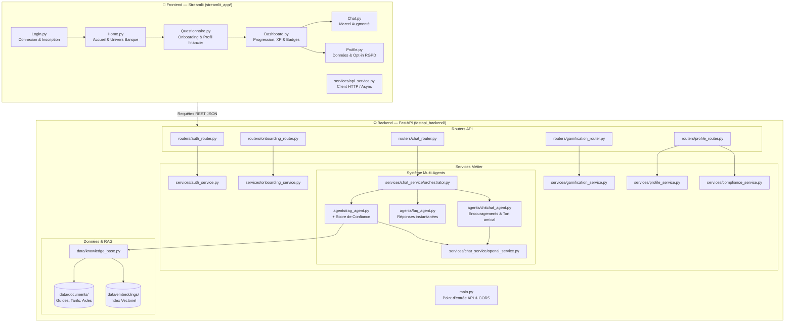

# 🏝️ Architecture Technique & Fonctionnelle — Projet Yellow (YellowBank)

Bienvenue dans la documentation d'architecture de l'application **Yellow**, le compagnon financier intelligent et gamifié conçu pour démystifier la banque et l'investissement auprès des jeunes adultes.

---

## 1. Schéma Global de l'Architecture


### Diagramme de flux et interactions (Mermaid)



---

## 2. Justification du Choix de la Stack Technique

### A. Pourquoi Streamlit pour l'Interface Utilisateur ?
1. **Vélocité de prototypage et itération rapide :** Streamlit permet de créer des interfaces interactives riches en pur Python, sans avoir à gérer la complexité d'un framework JavaScript lourd (React/Vue) au démarrage.
2. **Design mobile & composants natifs :** Grâce à nos fichiers CSS personnalisés ([style.css](file:///c:/Users/noerrami/Documents/YellowBank/streamlit_app/static/css/style.css)), nous adaptons l'interface au format smartphone tout en bénéficiant de composants natifs puissants (`st.chat_message`, `st.chat_input`, `st.progress`, cartes métriques).
3. **Session State dynamique :** Gestion fluide de la progression de l'utilisateur d'une page à l'autre (token d'authentification, réponses au questionnaire, historique de conversation).

### B. Pourquoi FastAPI pour le Backend ?
1. **Performances asynchrones de pointe (ASGI) :** Basé sur Starlette et Pydantic, FastAPI figure parmi les frameworks Python les plus rapides du marché, parfait pour absorber des requêtes de chat en streaming et des calculs RAG.
2. **Validation stricte des types & Sécurité :** Dans un contexte bancaire, la fiabilité des données financières est critique. Pydantic valide automatiquement chaque champ (revenus, montants d'emprunt, tokens).
3. **Documentation interactive automatique :** Génération immédiate des documentations OpenAPI (Swagger UI sur `/docs` et ReDoc sur `/redoc`), facilitant les tests d'intégration entre le frontend et le backend.
4. **Découplage architectural :** Si demain nous développons une application mobile native (Flutter/React Native), le backend FastAPI reste inchangé et prêt pour la production.

### C. Pourquoi un Système Multi-Agents Spécialisé ?
Plutôt que d'envoyer l'ensemble des requêtes brutes à un grand modèle de langage générique, nous utilisons un **Orchestrateur** qui qualifie l'intention du message et la confie à l'agent le plus pertinent :
1. **L'Agent RAG (`rag_agent.py`) :**  
   - Intervient sur les questions techniques bancaires (conditions de prêt, taux du Livret A, règles du PEA, éligibilité aux APL).  
   - **Garantie zéro hallucination** : la réponse est strictement ancrée dans nos documents vérifiés et accompagnée d'un **score de confiance** visible par l'utilisateur.
2. **L'Agent FAQ (`faq_agent.py`) :**  
   - Traite les questions récurrentes sans appel coûteux à un LLM externe (ex: "Comment faire opposition à ma carte ?"). Réponse instantanée et coût de token nul.
3. **L'Agent Chitchat (`chitchat_agent.py`) :**  
   - Assure l'accueil, les encouragements lors des missions et le dialogue amical dans l'univers de l'île "Yellow", en s'appuyant sur l'API d'OpenAI.

### D. Sécurité, Rôle de l'IA & Respect du RGPD
1. **"L'agent conseille, le client décide" :** Conformément aux règles de déontologie financière, l'agent ne réalise **jamais** d'action engageante à la place de l'utilisateur. Il propose des options claires, et l'utilisateur valide manuellement chaque étape.
2. **Contrôle strict de la confidentialité (Opt-in) :** Les conversations sont chiffrées. C'est l'utilisateur qui décide, via un réglage dédié dans son profil, de partager ou non un résumé de ses échanges et de ses besoins avec son conseiller bancaire humain.
3. **Score de confiance RAG :** Transparence totale : si le score de confiance documentaire est inférieur à un seuil défini (ex: < 70%), l'agent informe l'utilisateur qu'il s'agit d'une estimation et lui suggère de consulter son conseiller bancaire.

---

## 3. Cartographie Détaillée des Fichiers

### 📱 Frontend — `streamlit_app/`

| Fichier / Dossier | Rôle et Responsabilité |
| :--- | :--- |
| [Home.py](file:///c:/Users/noerrami/Documents/YellowBank/streamlit_app/Home.py) | **Page d'accueil principale :** Présente l'univers immersif d'Yellow, accueille l'utilisateur avec un message personnalisé et propose le bouton d'action *"Commencer"* vers le questionnaire d'entrée. |
| [Login.py](file:///c:/Users/noerrami/Documents/YellowBank/streamlit_app/Login.py) | **Écran d'authentification & inscription :** Formulaires sécurisés de connexion et création de compte client avec visuel d'ambiance bancaire. |
| [Questionnaire.py](file:///c:/Users/noerrami/Documents/YellowBank/streamlit_app/Questionnaire.py) | **Questionnaire d'onboarding :** Recueille en 4 étapes le profil (âge, statut pro), les objectifs (gestion courante, investissement, projet) et la maturité financière pour recommander l'un des 3 parcours types. |
| [Chat.py](file:///c:/Users/noerrami/Documents/YellowBank/streamlit_app/Chat.py) | **Interface du Conseiller Conversationnel :** Chat interactif affichant les messages, les sources documentaires, le **badge du score de confiance RAG** et des boutons d'actions suggérées. |
| [Dashboard.py](file:///c:/Users/noerrami/Documents/YellowBank/streamlit_app/Dashboard.py) | **Tableau de bord de suivi & Gamification :** Affiche la progression dans le parcours en cours, les missions actives, les badges débloqués, l'XP accumulée et les challenges ludiques. |
| [Profile.py](file:///c:/Users/noerrami/Documents/YellowBank/streamlit_app/Profile.py) | **Espace personnel & Conformité RGPD :** Consultation des coordonnées, état civil, soldes bancaires, réglage d'autorisation de partage des données avec le conseiller bancaire humain. |
| [static/css/style.css](file:///c:/Users/noerrami/Documents/YellowBank/streamlit_app/static/css/style.css) | **Feuille de style CSS :** Charte graphique inspirée d'Yellow/YellowBank (or ambré, bleu nuit, cartes en relief, badges dorés, responsive mobile). |
| [static/js/script.js](file:///c:/Users/noerrami/Documents/YellowBank/streamlit_app/static/js/script.js) | **Scripts JavaScript légers :** Micro-interactions côté client, gestion du défilement fluide du chat et animations. |
| [static/img/logo.png](file:///c:/Users/noerrami/Documents/YellowBank/streamlit_app/static/img/logo.png) | **Identité visuelle :** Logo officiel d'Yellow. |
| [static/img/badges/](file:///c:/Users/noerrami/Documents/YellowBank/streamlit_app/static/img/badges) | **Assets de gamification :** Icônes des badges à débloquer (*Premier Pas*, *Épargnant Sage*, *Explorateur PEA*, *Chasseur d'Aides*...). |
| [services/api_service.py](file:///c:/Users/noerrami/Documents/YellowBank/streamlit_app/services/api_service.py) | **Client API HTTP :** Encapsule tous les appels `httpx`/`requests` vers les routes FastAPI (authentification, envoi de message, validation de mission, scoring). |

---

### ⚙️ Backend — `fastapi_backend/`

#### Racine & Utilitaires
| Fichier | Rôle et Responsabilité |
| :--- | :--- |
| [main.py](file:///c:/Users/noerrami/Documents/YellowBank/fastapi_backend/main.py) | **Point d'entrée FastAPI :** Initialisation de l'application, configuration des middlewares CORS, montage des routeurs et gestion du cycle de vie (*lifespan*). |
| [utils.py](file:///c:/Users/noerrami/Documents/YellowBank/fastapi_backend/utils.py) | **Fonctions partagées :** Formatage de devises, hachage, calculs financiers (taux d'endettement, mensualités), validateurs génériques. |
| [requirements.txt](file:///c:/Users/noerrami/Documents/YellowBank/fastapi_backend/requirements.txt) | **Dépendances serveur :** `fastapi`, `uvicorn`, `pydantic`, `openai`, `numpy`, `pytest`, `python-dotenv`, `python-jose`, etc. |

#### Routers (`fastapi_backend/routers/`)
| Fichier | Rôle et Responsabilité |
| :--- | :--- |
| [auth_router.py](file:///c:/Users/noerrami/Documents/YellowBank/fastapi_backend/routers/auth_router.py) | **Endpoints d'authentification :** `/auth/login`, `/auth/register`, `/auth/refresh` et gestion des tokens JWT. |
| [onboarding_router.py](file:///c:/Users/noerrami/Documents/YellowBank/fastapi_backend/routers/onboarding_router.py) | **Endpoints du questionnaire :** Réception des réponses au questionnaire d'entrée et attribution du parcours recommandé (Courant, PEA ou Projets/Aides). |
| [chat_router.py](file:///c:/Users/noerrami/Documents/YellowBank/fastapi_backend/routers/chat_router.py) | **Endpoints de messagerie :** `/chat/message` pour poster un message utilisateur et recevoir la réponse enrichie (texte, agent émetteur, sources, score de confiance). |
| [gamification_router.py](file:///c:/Users/noerrami/Documents/YellowBank/fastapi_backend/routers/gamification_router.py) | **Endpoints de gamification :** Récupération de la progression de l'utilisateur, complétion d'une mission, déblocage d'un badge et classement amical. |
| [profile_router.py](file:///c:/Users/noerrami/Documents/YellowBank/fastapi_backend/routers/profile_router.py) | **Endpoints du profil :** Consultation/mise à jour des informations personnelles, gestion du consentement RGPD de partage conseiller, et génération du compte-rendu d'activité. |

#### Services Métier (`fastapi_backend/services/`)
| Fichier / Dossier | Rôle et Responsabilité |
| :--- | :--- |
| [services/chat_service/orchestrator.py](file:///c:/Users/noerrami/Documents/YellowBank/fastapi_backend/services/chat_service/orchestrator.py) | **Cœur de routage IA :** Analyse la requête de l'utilisateur, détermine l'intention et délègue le traitement à l'agent adéquat (RAG, FAQ ou Chitchat). |
| [services/chat_service/agents/rag_agent.py](file:///c:/Users/noerrami/Documents/YellowBank/fastapi_backend/services/chat_service/agents/rag_agent.py) | **Agent RAG :** Effectue la recherche sémantique dans la base documentaire, calcule le **score de confiance**, formule une réponse étayée et injecte les citations de sources. |
| [services/chat_service/agents/faq_agent.py](file:///c:/Users/noerrami/Documents/YellowBank/fastapi_backend/services/chat_service/agents/faq_agent.py) | **Agent FAQ :** Recherche exacte ou par similarité sur un catalogue de questions bancaires courantes pré-validées. |
| [services/chat_service/agents/chitchat_agent.py](file:///c:/Users/noerrami/Documents/YellowBank/fastapi_backend/services/chat_service/agents/chitchat_agent.py) | **Agent Conversationnel :** Gère la tonalité bienveillante, l'accueil, les encouragements après réussite d'une mission et les salutations. |
| [services/chat_service/openai_service.py](file:///c:/Users/noerrami/Documents/YellowBank/fastapi_backend/services/chat_service/openai_service.py) | **Connecteur OpenAI :** Encapsule les appels à l'API OpenAI (gestion des prompts système, des modèles `gpt-4o`/`gpt-4o-mini`, du contrôle des tokens et des réessais). |
| [auth_service.py](file:///c:/Users/noerrami/Documents/YellowBank/fastapi_backend/services/auth_service.py) | **Logique de sécurité :** Hachage des mots de passe (bcrypt/PBKDF2), génération et vérification des tokens JWT sécurisés. |
| [onboarding_service.py](file:///c:/Users/noerrami/Documents/YellowBank/fastapi_backend/services/onboarding_service.py) | **Moteur de recommandation de parcours :** Analyse les scores du questionnaire d'entrée et oriente vers le parcours optimal (*Courant*, *PEA* ou *Projets & Aides*). |
| [gamification_service.py](file:///c:/Users/noerrami/Documents/YellowBank/fastapi_backend/services/gamification_service.py) | **Moteur de jeu :** Catalogue des missions par parcours, calcul des points d'expérience (XP), règles de déclenchement des badges. |
| [compliance_service.py](file:///c:/Users/noerrami/Documents/YellowBank/fastapi_backend/services/compliance_service.py) | **Conformité & Synthèse Conseiller :** Gestion des consentements RGPD et génération du rapport de synthèse des besoins du client pour son conseiller bancaire. |
| [profile_service.py](file:///c:/Users/noerrami/Documents/YellowBank/fastapi_backend/services/profile_service.py) | **Gestion des données client :** Récupération et mise à jour des informations financières et personnelles de l'utilisateur. |

#### Modèles de Données (`fastapi_backend/models/`)
| Fichier | Rôle et Responsabilité |
| :--- | :--- |
| [user.py](file:///c:/Users/noerrami/Documents/YellowBank/fastapi_backend/models/user.py) | **Schéma Utilisateur :** Identifiant, nom, email, solde, parcours attribué, niveau d'XP, badges acquis et statut du consentement conseiller. |
| [mission.py](file:///c:/Users/noerrami/Documents/YellowBank/fastapi_backend/models/mission.py) | **Schémas Mission & Badge :** Structure d'une mission (titre, description, points XP, statut en cours/validé) et d'un badge de récompense. |
| [message.py](file:///c:/Users/noerrami/Documents/YellowBank/fastapi_backend/models/message.py) | **Schéma Message :** Rôle (`user`/`assistant`), contenu, timestamp, agent émetteur, score de confiance RAG et liste de sources/citations. |
| [conversation.py](file:///c:/Users/noerrami/Documents/YellowBank/fastapi_backend/models/conversation.py) | **Schéma Conversation :** Session de discussion regroupant les messages échangés entre un utilisateur et le système multi-agents. |

#### Données & RAG (`fastapi_backend/data/`)
| Fichier / Dossier | Rôle et Responsabilité |
| :--- | :--- |
| [data/documents/](file:///c:/Users/noerrami/Documents/YellowBank/fastapi_backend/data/documents) | **Corpus documentaire :** Fichiers markdown/PDF sur les tarifs bancaires, fiches pratiques PEA, guides d'aides aux jeunes (APL, bourses) et sécurité bancaire. |
| [data/embeddings/](file:///c:/Users/noerrami/Documents/YellowBank/fastapi_backend/data/embeddings) | **Index vectoriel :** Vecteurs pré-calculés des fragments documentaires pour la recherche sémantique ultra-rapide. |
| [knowledge_base.py](file:///c:/Users/noerrami/Documents/YellowBank/fastapi_backend/data/knowledge_base.py) | **Gestionnaire de base documentaire :** Découpage en fragments (*chunking*), génération des embeddings et recherche par similarité cosinus. |

#### Tests Automatisés (`fastapi_backend/tests/`)
| Fichier | Périmètre de Test |
| :--- | :--- |
| [test_auth.py](file:///c:/Users/noerrami/Documents/YellowBank/fastapi_backend/tests/test_auth.py) | Tests unitaires de connexion, hachage de mot de passe et validité des tokens JWT. |
| [test_chat.py](file:///c:/Users/noerrami/Documents/YellowBank/fastapi_backend/tests/test_chat.py) | Tests de l'orchestrateur de chat et du calcul du score de confiance RAG. |
| [test_onboarding.py](file:///c:/Users/noerrami/Documents/YellowBank/fastapi_backend/tests/test_onboarding.py) | Tests de l'algorithme d'orientation vers les 3 parcours selon les réponses au questionnaire. |
| [test_gamification.py](file:///c:/Users/noerrami/Documents/YellowBank/fastapi_backend/tests/test_gamification.py) | Tests de progression, complétion de missions et déblocage des badges. |
| [test_profile.py](file:///c:/Users/noerrami/Documents/YellowBank/fastapi_backend/tests/test_profile.py) | Tests de mise à jour du profil utilisateur et des drapeaux de consentement RGPD. |

---

## 4. Les 3 Parcours Types dans l'Application

Conformément à la vision d'Yellow, chaque utilisateur est dirigé vers l'un des 3 parcours suivants suite à son questionnaire d'entrée :

```
┌────────────────────────────────────────────────────────────────────────┐
│                        QUESTIONNAIRE D'ENTRÉE                         │
│             (Profil perso + Objectifs financiers + Niveau)             │
└───────────────────────────────────┬────────────────────────────────────┘
                                    │
           ┌────────────────────────┼────────────────────────┐
           ▼                        ▼                        ▼
┌──────────────────────┐ ┌──────────────────────┐ ┌──────────────────────┐
│  a) PARCOURS COURANT │ │   b) PARCOURS PEA    │ │c) PROJETS & AIDES    │
│  Mieux gérer l'argent│ │  Découverte bourse   │ │  Financer ses projets│
│     au quotidien     │ │  de façon progressive│ │  & optimiser les aides│
├──────────────────────┤ ├──────────────────────┤ ├──────────────────────┤
│ Missions clés :      │ │ Missions clés :      │ │ Missions clés :      │
│ • Paramétrer alerte  │ │ • Comprendre le PEA  │ │ • Simuler les APL    │
│   solde bas          │ │ • 1ers 100€ investis │ │ • Budgéter logement  │
│ • Catégoriser budget │ │ • Suivi portefeuille │ │ • Certif. scolarité  │
│ 🏅 Badge "Gestion"   │ │ 🏅 Badge "Invest"    │ │ 🏅 Badge "Projet"    │
└──────────────────────┘ └──────────────────────┘ └──────────────────────┘
```

---

## 5. Prise en Main et Commandes

### 1. Démarrer le Backend FastAPI
```bash
cd fastapi_backend
pip install -r requirements.txt
uvicorn main:app --reload --port 8000
```
*Documentation Swagger accessible sur : `http://localhost:8000/docs`*

### 2. Démarrer le Frontend Streamlit
```bash
cd streamlit_app
streamlit run Home.py
```
*Application accessible sur : `http://localhost:8501`*

---
*Document créé pour le projet Yellow / YellowBank — Tous droits réservés.*
