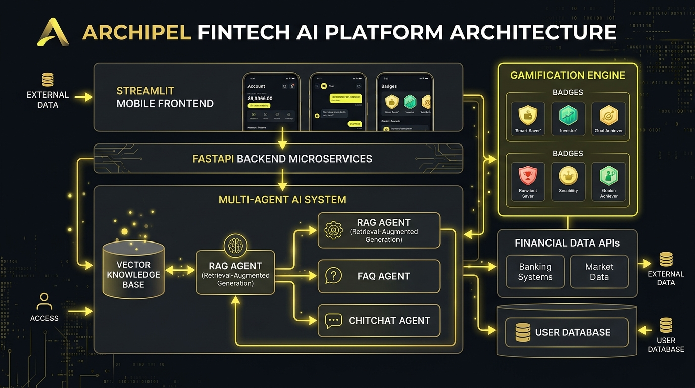

# 🏝️ Archipel (YellowBank) — Compagnon Financier Intelligent & Gamifié

Application bancaire et d'investissement nouvelle génération combinant une interface mobile **Streamlit**, un backend asynchrone **FastAPI**, un système **Multi-Agents IA (RAG, FAQ, Chitchat)** et un moteur de **Gamification** (missions, badges, 3 parcours d'accompagnement).

---

## 📖 Documentation d'Architecture

Consultez le document complet d'architecture avec schéma visuel et description détaillée de chaque fichier :  
👉 **[Lire la documentation complète : ARCHITECTURE.md](ARCHITECTURE.md)**



---

## 📁 Structure du Projet

```text
YellowBank/
├── streamlit_app/              # Frontend Streamlit (Interface mobile, chat, missions, profil)
│   ├── Home.py
│   ├── Login.py
│   ├── Questionnaire.py
│   ├── Chat.py
│   ├── Dashboard.py
│   ├── Profile.py
│   ├── static/ (css, js, img)
│   └── services/api_service.py
├── fastapi_backend/            # Backend FastAPI (Microservices, IA, Gamification, Auth)
│   ├── main.py
│   ├── routers/ (auth, onboarding, chat, gamification, profile)
│   ├── services/ (chat_service, auth, onboarding, gamification, compliance)
│   ├── models/ (user, mission, message, conversation)
│   ├── data/ (documents, embeddings, knowledge_base.py)
│   ├── tests/
│   ├── utils.py
│   └── requirements.txt
├── docs/                       # Visuels et assets de documentation
│   └── architecture.png
├── ARCHITECTURE.md             # Guide d'architecture exhaustif
└── Readme.md
```

---

## 🚀 Démarrage Rapide

### 1. Lancer le Backend FastAPI
```bash
cd fastapi_backend
pip install -r requirements.txt
uvicorn main:app --reload --port 8000
```
Swagger UI : `http://localhost:8000/docs`

### 2. Lancer le Frontend Streamlit
```bash
cd streamlit_app
streamlit run Home.py
```
Interface web : `http://localhost:8501`
